# 엔티티 연관관계도 (ERD)

Crosscert Passkey Platform 의 JPA 엔티티(`core/src/main/java/com/crosscert/passkey/core/entity/`) 간
연관관계입니다. `@Entity` 클래스는 21개이며(그 외 `BaseEntity` = mapped superclass,
`AdminUserTenantId` = 복합 PK 클래스), Flyway baseline
(`core/src/main/resources/db/migration/V1__baseline_schema.sql` + 증분 V2~V5)이 만드는
테이블과 대응합니다. 두 개의 집합(aggregate)으로 나뉩니다.

- **TENANT 집합** — 패스키 운영 데이터 (credential, api_key, 정책·설정, ceremony/인증 이벤트)
- **ADMIN_USER 집합** — 관리 콘솔 계정 (recovery code, reset token, signup request)
- 두 집합은 **`admin_user_tenant` N:M 매핑 테이블**로 연결됩니다. `admin_user` 에는
  tenant 컬럼이 없습니다. `RP_ADMIN` 은 매핑 행을 1개 이상 가지고(앱 레벨에서 검증),
  `PLATFORM_OPERATOR` 는 매핑 행이 0개입니다(전체 접근).

> **FK 와 "(soft)" 표기**: 대부분의 테이블에는 **DB 레벨 FK 제약이 실재합니다**
> (`fk_credential_tenant`·`fk_api_key_tenant`·`fk_aut_admin_user`(CASCADE)·`fk_aut_tenant`·
> `fk_pwd_reset_admin_user`·`fk_recovery_admin_user`·`fk_cred_auth_event_credential` 등
> V1 에 13건). FK 제약이 **없는** 테이블은 `audit_log`·`ceremony_event`·`security_incident`
> 셋뿐이고, `admin_user` 도 tenant 를 직접 참조하지 않습니다.
>
> 아래 다이어그램의 **"(soft)" 는 "JPA 연관 어노테이션(`@ManyToOne`/`@OneToMany`)이 없고
> `UUID tenantId` 같은 ID 컬럼만 매핑돼 있다"** 는 뜻입니다(멀티테넌트 격리는 앱 레벨
> Hibernate `@Filter tenantFilter` 로 수행하며, Oracle row-level security 기반 격리는
> 사용하지 않습니다). 즉 DB 무결성은
> FK 가 지키지만 객체 그래프 탐색은 안 되므로, 조회 시 tenant 를 함께 보려면 JOIN 을 직접
> 걸어야 합니다.

## 다이어그램

```mermaid
erDiagram
    TENANT ||--o{ TENANT_ALLOWED_ORIGIN : "has (JPA)"
    TENANT ||--o{ TENANT_ACCEPTED_FORMAT : "has (JPA)"
    TENANT ||--o| TENANT_AAGUID_POLICY : "1:1 (soft)"
    TENANT_AAGUID_POLICY ||--o{ TENANT_AAGUID_POLICY_ENTRY : "has (@ElementCollection)"
    TENANT ||--o| TENANT_WEBAUTHN_SNAPSHOT : "1:1 cache (soft)"
    TENANT ||--o{ CREDENTIAL : "has (soft)"
    CREDENTIAL ||--o{ CREDENTIAL_AUTH_EVENT : "has (soft)"
    TENANT ||--o{ API_KEY : "has (soft)"
    API_KEY ||--o{ API_KEY_SCOPE : "has (JPA)"
    TENANT ||--o{ CEREMONY_EVENT : "has (soft, no FK)"
    ADMIN_USER ||--o{ ADMIN_USER_TENANT : "scopes RP_ADMIN (soft)"
    TENANT ||--o{ ADMIN_USER_TENANT : "scoped by (soft)"
    ADMIN_USER ||--o{ ADMIN_USER_RECOVERY_CODE : "has (soft)"
    ADMIN_USER ||--o{ ADMIN_PASSWORD_RESET_TOKEN : "has (soft)"
    ADMIN_USER ||--o{ AUDIT_LOG : "actor (soft, nullable, no FK)"
    TENANT ||--o{ AUDIT_LOG : "scope (soft, nullable, no FK)"
    TENANT ||--o{ SECURITY_INCIDENT : "raised for (soft, no FK)"

    TENANT {
        RAW16 id PK
        string slug UK
        string display_name
        string rp_id
        string rp_name
        string status
        char require_user_verification
        char mds_required
        string attestation_conveyance
        number webauthn_timeout_ms
    }
    TENANT_ALLOWED_ORIGIN {
        RAW16 id PK
        RAW16 tenant_id FK
        string origin "https:// 또는 android:apk-key-hash:"
        number sort_order
    }
    TENANT_ACCEPTED_FORMAT {
        RAW16 id PK
        RAW16 tenant_id FK
        string format
    }
    TENANT_AAGUID_POLICY {
        RAW16 tenant_id PK "FK → TENANT"
        string policy_mode "ANY|ALLOWLIST|DENYLIST"
        char mds_strict
    }
    TENANT_AAGUID_POLICY_ENTRY {
        RAW16 tenant_id PK "FK → TENANT_AAGUID_POLICY"
        RAW16 aaguid PK
        string note
    }
    TENANT_WEBAUTHN_SNAPSHOT {
        NUMBER id PK
        RAW16 tenant_id FK "1행/테넌트"
        string rp_id
        string rp_name
        clob allowed_origins
        clob accepted_formats
    }
    CREDENTIAL {
        RAW16 id PK
        RAW16 tenant_id FK
        bytes user_handle
        bytes credential_id
        blob cose_public_key "COSE"
        long sign_count
        bytes aaguid
        string transports
        string attestation_fmt
        string label
    }
    CREDENTIAL_AUTH_EVENT {
        RAW16 id PK
        RAW16 credential_id FK "CASCADE"
        RAW16 tenant_id "soft"
        string result
        string failure_reason
        long sign_count
    }
    API_KEY {
        RAW16 id PK
        RAW16 tenant_id FK
        string key_prefix UK
        string key_hash "bcrypt"
        string name
        instant expires_at
        instant revoked_at
    }
    API_KEY_SCOPE {
        RAW16 id PK
        RAW16 api_key_id FK
        string scope "registration|authentication|admin"
    }
    CEREMONY_EVENT {
        RAW16 id PK
        RAW16 tenant_id "soft, FK 없음"
        string action
    }
    ADMIN_USER {
        RAW16 id PK
        string email UK
        string bcrypt_hash "bcrypt"
        string role "PLATFORM_OPERATOR|RP_ADMIN"
        char enabled
        string status "ACTIVE|PENDING|SUSPENDED"
        char mfa_enabled
        string mfa_secret "AES-GCM enc"
        number failed_login_count
        instant locked_until
        number mfa_failed_count "V3"
        number mfa_last_totp_step "V2, replay guard"
    }
    ADMIN_USER_TENANT {
        RAW16 admin_user_id PK "FK → ADMIN_USER, CASCADE"
        RAW16 tenant_id PK "FK → TENANT"
        string created_by
    }
    ADMIN_USER_RECOVERY_CODE {
        RAW16 id PK
        RAW16 admin_user_id FK "CASCADE"
        string code_hash "sha-256"
        instant used_at
    }
    ADMIN_PASSWORD_RESET_TOKEN {
        NUMBER id PK
        RAW16 admin_user_id FK "CASCADE"
        string token_hash UK "sha-256"
        string token_prefix
        instant expires_at
        instant consumed_at
    }
    ADMIN_SIGNUP_REQUEST {
        RAW16 id PK
        string email UK
        string bcrypt_hash
        string reason
        instant requested_at
    }
    AUDIT_LOG {
        RAW16 id PK
        RAW16 actor_id "soft, nullable, FK 없음"
        string actor_email
        string action
        RAW16 tenant_id "soft, nullable, FK 없음"
        bytes prev_hash "global chain"
        bytes hash "global chain"
        bytes tenant_prev_hash "tenant chain"
        bytes tenant_hash "tenant chain"
        clob payload
    }
    SECURITY_INCIDENT {
        RAW16 id PK
        RAW16 tenant_id "soft, FK 없음"
        RAW16 tampered_entry_id
        string type "AUDIT_CHAIN_TAMPER"
        string severity "LOW|MEDIUM|HIGH|CRITICAL"
        string status "OPEN|RESOLVED"
    }
```

## 독립 테이블 (관계 없음 — 플랫폼 전역)

아래 테이블은 다른 엔티티와 관계가 없는 전역 싱글톤/캐시/인프라입니다.

| 테이블 | 역할 | 비고 |
|---|---|---|
| `SIGNING_KEY` | JWT RS256 서명키 | `public_jwk`(공개, JWKS 노출) + `private_pkcs8`(AES-GCM 암호화). `kid` UK |
| `MDS_BLOB_CACHE` | FIDO MDS 블롭 메타 캐시 | 고정 SINGLETON_ID. `blob_jwt` 컬럼은 제거됨 |
| `MDS_SYNC_HISTORY` | MDS 동기화 이력 | **JPA 엔티티 없음** — `admin-app` 의 `MdsHistoryService` 가 raw JDBC 로 읽고 쓴다 |
| `SECURITY_POLICY` | 전역 보안 설정 | 싱글톤(`id = 1` CHECK). 세션 타임아웃·CORS allowlist·MFA 필수 |
| `SCHEDULER_LEASE` | 배치 리더 선출 lease | `name`(UK)·`holder`·`expires_at` |
| `ADMIN_SIGNUP_REQUEST` | 승인 대기 중인 가입 요청 | V5 로 추가. FK 없음(독립). 승인/거절 시 삭제(이력은 `audit_log`) |

`SECURITY_INCIDENT` 는 `tenant_id` 를 갖지만 FK 제약 없이 컬럼만 두므로 위 다이어그램에
soft 로만 표기합니다. `ADMIN_USER_INVITATION` 테이블(초대 흐름)은 V5 에서 시퀀스와 함께 **DROP** 되어
더 이상 존재하지 않습니다 — V1 baseline 에만 남아 있는 이유는 squash baseline 이 당시
스키마를 그대로 담고 있기 때문입니다.

## 관계 요약표

| 부모 | 자식 | 관계 | 연결 방식 | DB FK / cascade |
|---|---|---|---|---|
| TENANT | TENANT_ALLOWED_ORIGIN | 1:N | JPA `@ManyToOne` | `fk_tao_tenant` ON DELETE CASCADE + JPA orphanRemoval |
| TENANT | TENANT_ACCEPTED_FORMAT | 1:N | JPA `@ManyToOne` | `fk_taf_tenant` ON DELETE CASCADE + JPA orphanRemoval |
| TENANT | TENANT_AAGUID_POLICY | 1:1 | soft (tenant_id = PK) | `fk_tenant_aaguid_policy_tenant` ON DELETE CASCADE |
| TENANT_AAGUID_POLICY | TENANT_AAGUID_POLICY_ENTRY | 1:N | JPA `@ElementCollection`(`Entry` embeddable) | `fk_tenant_aaguid_policy_entry_policy` ON DELETE CASCADE |
| TENANT | TENANT_WEBAUTHN_SNAPSHOT | 1:1 | soft (테넌트당 1행) | `fk_tenant_webauthn_snapshot_tenant` ON DELETE CASCADE |
| TENANT | CREDENTIAL | 1:N | soft (`UUID tenantId`) | `fk_credential_tenant` |
| CREDENTIAL | CREDENTIAL_AUTH_EVENT | 1:N | soft (`UUID credentialId`) | `fk_cred_auth_event_credential` ON DELETE CASCADE |
| TENANT | API_KEY | 1:N | soft | `fk_api_key_tenant` |
| API_KEY | API_KEY_SCOPE | 1:N | JPA `@ManyToOne` | `fk_aks_api_key` ON DELETE CASCADE + JPA orphanRemoval |
| TENANT | CEREMONY_EVENT | 1:N | soft | **FK 없음** |
| ADMIN_USER ↔ TENANT | ADMIN_USER_TENANT | **N:M** | soft (복합 PK 매핑 엔티티) | `fk_aut_admin_user` ON DELETE CASCADE / `fk_aut_tenant` |
| ADMIN_USER | ADMIN_USER_RECOVERY_CODE | 1:N | soft (`admin_user_id`) | `fk_recovery_admin_user` ON DELETE CASCADE |
| ADMIN_USER | ADMIN_PASSWORD_RESET_TOKEN | 1:N | soft | `fk_pwd_reset_admin_user` ON DELETE CASCADE |
| ADMIN_USER | AUDIT_LOG | 1:N | soft (`actor_id`, nullable) | **FK 없음** |
| TENANT | AUDIT_LOG | 1:N | soft (`tenant_id`, nullable) | **FK 없음** |
| TENANT | SECURITY_INCIDENT | 1:N | soft (`tenant_id`) | **FK 없음** |

> **PK 타입 주의**: 대부분의 PK/FK 는 Oracle `RAW(16)`(바이너리 UUID) 입니다
> (`ADMIN_PASSWORD_RESET_TOKEN`·`TENANT_WEBAUTHN_SNAPSHOT`·`MDS_SYNC_HISTORY` 의 `id` 는
> `NUMBER`, `SECURITY_POLICY` 는 `NUMBER(1)` 싱글톤). DB 직접 조회 시 `RAWTOHEX(id)` 로 hex
> 문자열을, tenant 식별은 `tenant` 테이블과 JOIN(`slug`/`display_name`) 으로 사람이 읽게
> 만들 수 있습니다.
